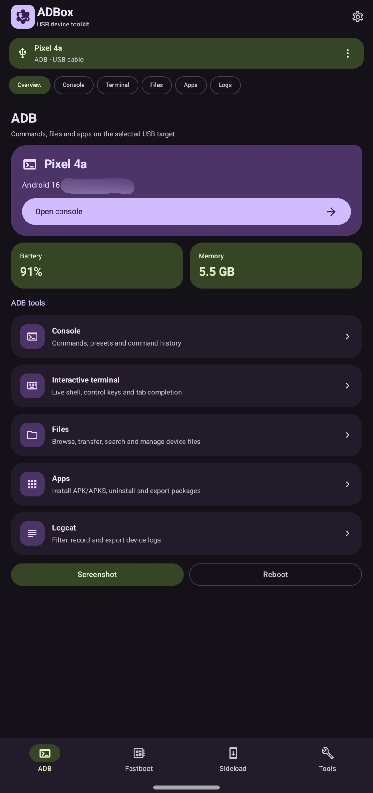
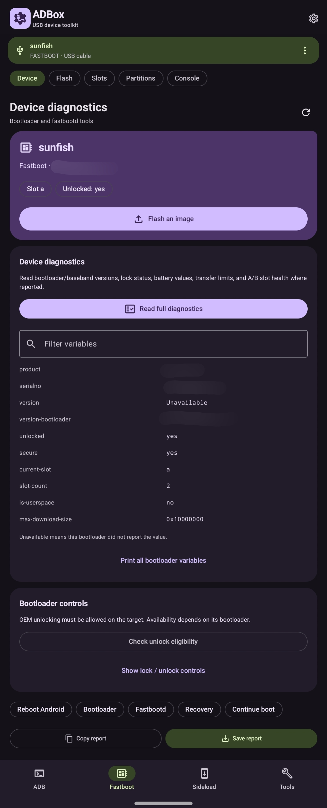
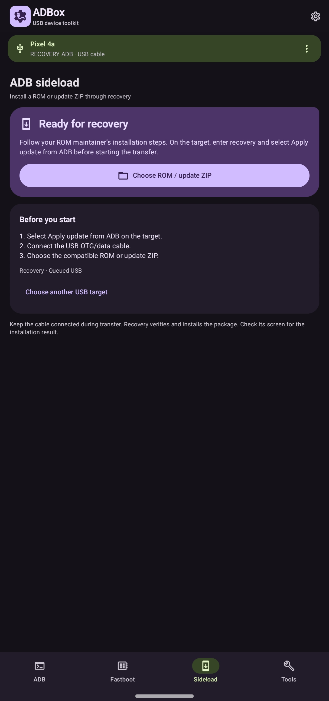
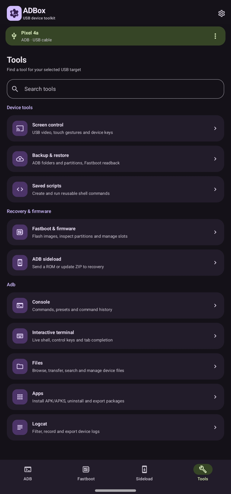

# ADBox

An Android toolkit for controlling another Android device over USB, built with Material 3 Expressive.

- **ADB:** console, terminal, files, apps, and Logcat.
- **Fastboot:** device diagnostics, IMG/DTBO flashing, slots, and partitions.
- **Sideload:** recovery ZIP transfers with progress and error details.
- **Tools:** screen mirroring/control, screenshots, backups, and saved scripts.

Requires Android 8.0+ and a USB OTG/data cable.

## Screenshots

<table>
  <tr>
    <td align="center" valign="top"> <b>ADB</b></td>
    <td align="center" valign="top"> <b>Fastboot</b></td>
    <td align="center" valign="top"> <b>Sideload</b></td>
    <td align="center" valign="top"> <b>Tools</b></td>
  </tr>
</table>

## License

ADBox is licensed under the [Apache License 2.0](LICENSE).
